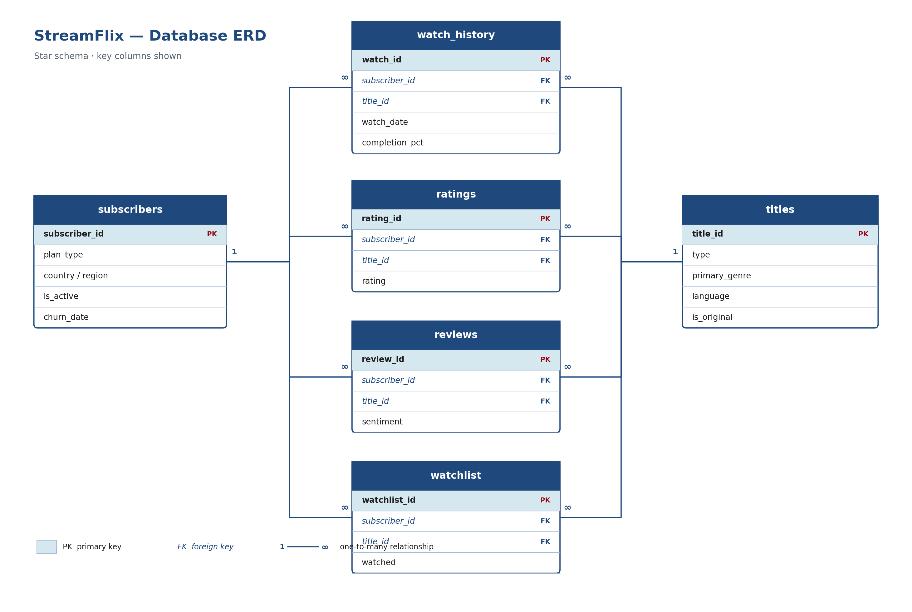
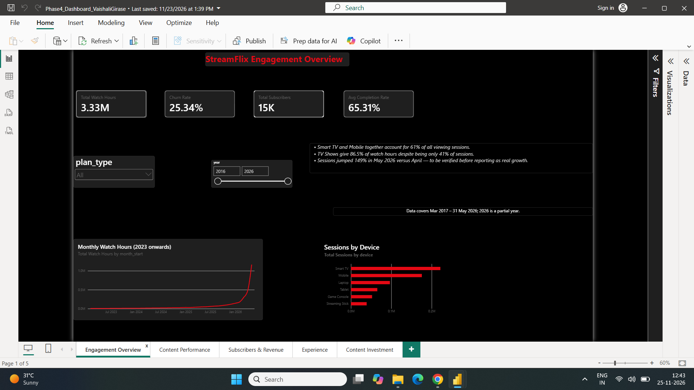
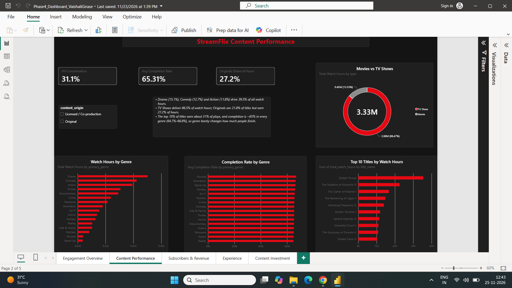

# StreamFlix Content Analytics

End-to-end analytics project on a streaming platform: data cleaning and quality checks, exploratory analysis, KPI development, SQL schema, a 5-page Power BI dashboard, and a management report for the CEO with recommendations.


---

## 📖 Project Overview

I worked as a Junior Data Analyst for **StreamFlix**, a fictional streaming platform. Using **979,000 records across 6 tables** (March 2017 to 31 May 2026), I checked the data quality, explored viewing and subscriber behaviour, calculated 10 business KPIs, built a Power BI dashboard, and wrote a management summary with risks, opportunities and recommendations.

## 🎯 Business Questions

- How healthy is the business? Are we meeting our targets for active subscribers, churn, completion and watchlist conversion?
- Which genres and content types drive viewing?
- Who is cancelling, and what does an at-risk subscriber look like?
- Are our Originals worth what we spend on them?
- Which licensed titles are about to expire?

## 🗂️ Dataset

| Table | Rows |
|---|---|
| subscribers | 15,000 |
| titles | 9,000 |
| watch_history | 650,000 |
| ratings | 130,000 |
| reviews | 110,000 |
| watchlist | 65,000 |
| **Total** | **979,000** |

Period covered: March 2017 – 31 May 2026

### Database Schema (ERD)

A star schema: four activity tables (watch_history, ratings, reviews, watchlist) connect `subscribers` and `titles`.



## 🔄 Workflow

```
Data Cleaning → EDA → KPI Calculation → Power BI Dashboard → Management Report
```

## 🧹 Phase 1 – Data Cleaning & Quality Report

Profiled all 6 tables and checked nulls, duplicates, data types, outliers and links between tables.

- **No duplicate primary keys** and **no broken links** between tables
- Removed duplicate rating and watchlist records (ratings 130,000 → 129,800; watchlist 65,000 → 64,939)
- Found a **logical data issue:** **131,199 viewing sessions (20.2%)** are dated *after* the subscriber had already cancelled. I flagged these rows instead of deleting them, and calculated KPIs both ways
- Long sessions (up to about 95 hours) are not errors: TV shows combine all seasons into one runtime

📓 [`Phase1_DataCleaning_VaishaliGirase.ipynb`](Phase1_DataCleaning_VaishaliGirase.ipynb)

## 📈 Phase 2 – Exploratory Data Analysis

10 charts, each with a written observation:

- Monthly viewing volume and watch-hour trend
- Genre share, content type split (Movies vs TV Shows)
- Top 10 countries, plan distribution, device usage, age groups
- Completion rate by genre, review sentiment

**Highlights:** TV Shows are 41% of sessions but **86.5% of watch hours**. Drama, Comedy and Action bring **39.5%** of hours. The United States alone gives **27.3%** of hours, and the top 10 countries give 83.4%.

📓 [`Phase2_EDA_VaishaliGirase.ipynb`](Phase2_EDA_VaishaliGirase.ipynb)

## 📊 Phase 3 – KPI Analysis

| KPI | Result | Target | Status |
|---|---|---|---|
| Active Rate | 74.7% | > 70% | ✅ Met |
| Churn Rate | 25.3% | < 30% | ✅ Met |
| Average Completion Rate | 65.3% | > 60% | ✅ Met |
| Watchlist Conversion | 46.2% | > 40% | ✅ Met |
| Monthly Recurring Revenue (MRR) | $175,869 | – | – |
| ARPU | $15.70 | – | – |
| Total Watch Hours | 3,333,468 | – | – |
| Hit Concentration (top 10% of titles) | 31.0% of plays | – | – |
| Originals Share of Hours | 27.2% | – | – |

Deep-dives: **at-risk subscriber profile**, **content investment efficiency** (watch hours per $1,000 of cost) and **cohort retention**.

📓 [`Phase3_KPIs_VaishaliGirase.ipynb`](Phase3_KPIs_VaishaliGirase.ipynb)

## 🗄️ SQL

Database schema and SQL queries: [`schema_and_sql.sql`](schema_and_sql.sql)

## 📊 Phase 4 – Power BI Dashboard

A 5-page interactive dashboard: **Engagement Overview, Content Performance, Subscribers & Revenue, Experience, Content Investment**, with KPI cards, slicers and a written insight on each page.

### Engagement Overview


### Content Performance


### Subscribers & Revenue


Basic with Ads churns at 34.3% vs 18.1% for Premium. Premium is only 32.5% of active subscribers but brings 47.6% of MRR.

### Experience


### Content Investment


Originals take 38.4% of the content budget but earn only 27.2% of viewing time.

📁 Power BI file: [`Phase4_Dashboard_VaishaliGirase.pbix`](Phase4_Dashboard_VaishaliGirase.pbix)
📄 Management report: [`Phase4_Report_VaishaliGirase.docx`](Phase4_Report_VaishaliGirase.docx)

## 💡 Key Findings

1. **The cheapest plan loses the most customers.** 34.3% of Basic with Ads subscribers have cancelled, vs 24.1% on Standard and 18.1% on Premium. People who live alone also cancel more (28.5%) than households of three (17.8%).
2. **New customers stay for a shorter time.** One-year retention was **96.2%** for 2016 sign-ups, **91.0%** for 2023 and only **80.4%** for 2025.
3. **Originals cost more than they return.** They are 21.8% of titles and take **38.4%** of the content budget ($8.15B of $21.21B), but earn **27.2%** of viewing. Per $1,000 spent, Originals return about 0.11 viewing hours vs about 0.19 for licensed titles.
4. **795 licensed titles expire by mid-May 2027.** Together they account for 8.3% of all viewing time.
5. **The data needs checking.** About 1 in 5 viewing records is dated after the subscriber cancelled, and May 2026 viewing is far higher than April.

## ✅ Recommendations

1. **Start a first-year care programme** for new customers (personal suggestions and watchlist reminders in the first 90 days). Goal: bring one-year retention back towards 90%.
2. **Encourage Basic with Ads subscribers to upgrade** with a short free trial of Standard or Premium. Every 1,000 subscribers who move to Premium adds about $16,000 a month.
3. **Set a viewing-per-dollar rule for new Originals** and move part of the budget to Animation, Kids & Family and Documentary, which return the most viewing per dollar.
4. **Decide licence renewals by viewing,** starting with the 795 titles expiring by mid-May 2027.
5. **Fix the data issues** (viewing after cancellation, the May 2026 jump) before using the totals for financial planning.

## 🛠️ Tools Used

Python (Pandas, Matplotlib), SQL, Power BI, Word

## 📁 Repository Structure

```
streamflix-analytics/
├── Phase1_DataCleaning_VaishaliGirase.ipynb   # Data cleaning & quality report
├── Phase2_EDA_VaishaliGirase.ipynb            # Exploratory data analysis (10 charts)
├── Phase3_KPIs_VaishaliGirase.ipynb           # 10 KPIs, churn, content investment, cohort retention
├── Phase4_Dashboard_VaishaliGirase.pbix       # 5-page Power BI dashboard
├── Phase4_Report_VaishaliGirase.docx          # Management summary report
├── schema_and_sql.sql                         # Database schema and SQL
├── StreamFlix_ERD.png                         # ER diagram
├── dashboard-1-overview.png ... dashboard-5.png
└── README.md
```

*The raw data files are not included in this repository.*

## 👩‍💻 About Me

**Vaishali Girase** – Aspiring Data Analyst | Excel · SQL · Power BI · Tableau
Valsad, Gujarat, India
💼 [LinkedIn](https://www.linkedin.com/in/vaishali-girase-539bb2433/)
